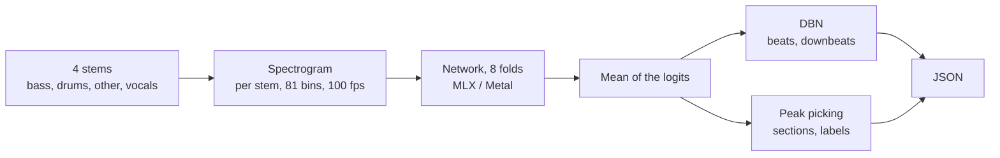

# tactus

Beat, downbeat, tempo and section analysis in Swift, running on the Mac GPU (MLX / Metal).

*Tactus* is the music-theory term for the pulse a listener taps along to, which is what this models.

It implements the model from **All-In-One Metrical And Functional Structure Analysis With Neighborhood Attentions on Demixed Audio** (Taejun Kim and Juhan Nam, WASPAA 2023, [arXiv 2307.16425](https://arxiv.org/abs/2307.16425)), using the authors' pretrained weights ([`taejunkim/allinone`](https://huggingface.co/taejunkim/allinone) on Hugging Face, MIT). It is not a different model: it reproduces the output of the reference implementation, [`mir-aidj/all-in-one`](https://github.com/mir-aidj/all-in-one) (MIT), which relies on NATTEN kernels that have no Metal version.

## Usage

Needs a Mac with Apple silicon and Xcode with the Metal Toolchain (`xcodebuild -downloadComponent MetalToolchain`); `swift build` alone does not compile MLX's shaders. The weights are converted once with `tools/convert.py` (see [PLAN.md](PLAN.md)) into `weights/`.

```
xcodebuild build -scheme tactus-cli -configuration Release -destination 'platform=macOS' -derivedDataPath .build/xcode
alias tactus=.build/xcode/Build/Products/Release/tactus-cli

tactus analyze path/to/stems                       # bass, drums, other, vocals as .wav .mp3 .m4a or .flac; JSON on stdout
tactus serve --port 8080                           # listens on 127.0.0.1 only
curl -F bass=@bass.wav -F drums=@drums.wav -F other=@other.wav -F vocals=@vocals.wav http://127.0.0.1:8080/analyze
```

Options: `--weights DIR` (default `weights`). The server analyzes one song at a time; there is no authentication, which is why it only binds to the loopback address.

See [PLAN.md](PLAN.md) for the work plan, measurements and status.

## Architecture



**Input and output.** The input is the four Demucs stems of a song; separation itself is out of scope. WAV, MP3, M4A and FLAC are decoded with AVFoundation (the format is detected from the content) and resampled to 44.1 kHz when they are not already; compressed files are rounded to 16 bits before the mono mix, as madmom gets them from ffmpeg. The output is JSON in the same shape as `allin1`: `bpm`, `beats`, `downbeats`, `beat_positions`, `segments`.

### Spectrogram

Each stem is processed on its own: mono, 44.1 kHz, 2048-sample frames with a hop of 441 (100 fps), STFT, a logarithmic filterbank with 12 bands per octave from 30 to 17000 Hz (normalized), and `log(1 + x)`. The result is 81 bins per frame, so a song becomes a `4 × T × 81` tensor (a 4-minute song has about 24,000 frames).

### Network

A small model (24 embedding dimensions, 2 heads), run once per stem and fold:

- **Embedding:** three 2D convolutions with max-pooling over frequency only, reducing 81 bins to one 24-dimensional vector per frame.
- **Encoder:** 11 blocks. Each has a *time layer* (two parallel 1D neighborhood attentions, kernel 5, with dilation `2^i` and `2·2^i`, concatenated and followed by an MLP) and an *instrument layer* (2D neighborhood attention across the 4 stems and time, 5×5 window).
- **Heads:** beat, downbeat, section boundary, and function label (start, end, intro, outro, break, bridge, inst, solo, verse, chorus).
- **Ensemble:** 8 folds, mean of their logits.

### Neighborhood attention without NATTEN

NATTEN is used through four functions (`natten{1,2}d{qkrpb,av}`). Here they are written with `gather` and `softmax`:

1. For each position, compute the indices of its `k` neighboring keys and of the learned relative position bias, with NATTEN's border rules: the window slides to stay inside the sequence, and with dilation `d` the sequence is treated as `d` interleaved subsequences.
2. Gather keys and values, compute `q·k + bias`, `softmax`, then the weighted sum of values.

Memory is `O(T·k)`, never `O(T²)`. As in the reference, sequences shorter than the window (and the 4 stems, for the 2D layer) are zero-padded to the window size.

### Post-processing

Runs on the CPU, ported from the reference:

- **Beats and downbeats:** a dynamic Bayesian network (Böck et al., as in madmom's `DBNDownBeatTrackingProcessor`): 3 or 4 beats per bar, 55–215 BPM over 60 tempo states, transition λ 100, observation λ 16, 100 fps, with the downbeat threshold taken from the checkpoints.
- **Tempo:** the most frequent rounded inter-beat BPM.
- **Sections:** local maxima of the section activation, then peak picking over a ±12 s window gives the boundaries; each segment takes the label with the highest mean probability.

## License

To be decided. The upstream code and weights are MIT; the DBN and the spectrogram are derived from madmom (BSD). See [NOTICE](NOTICE).
